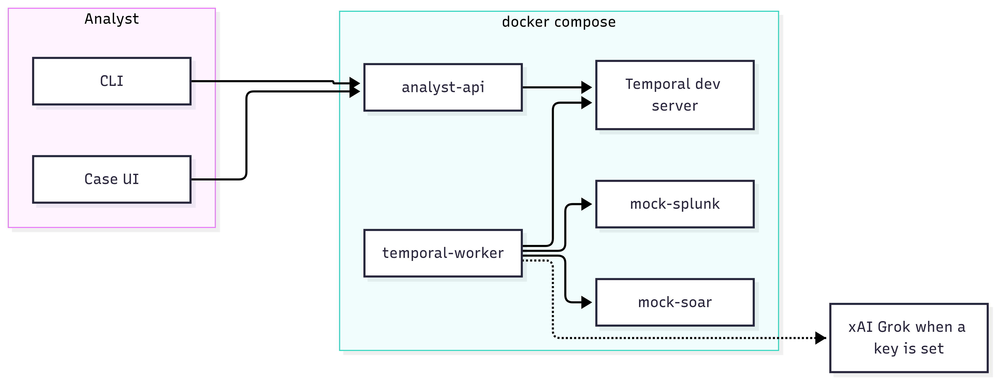
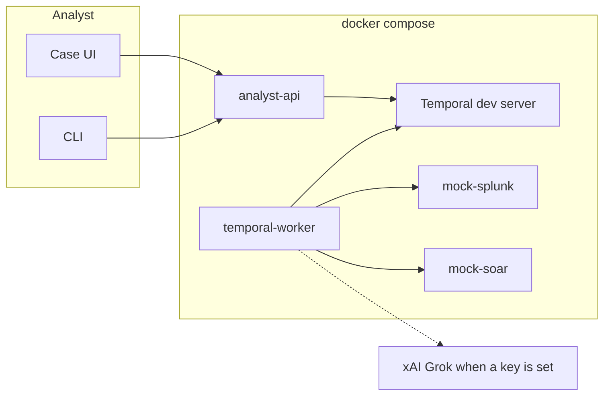
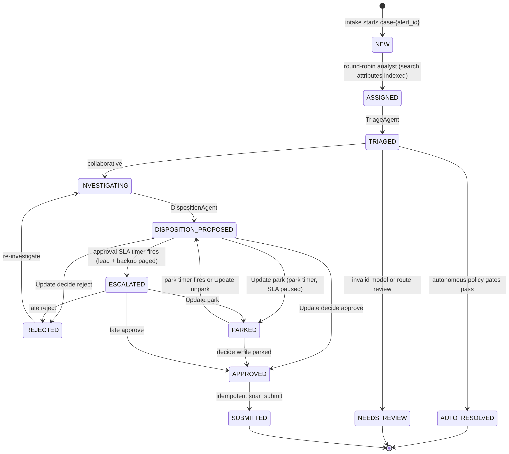
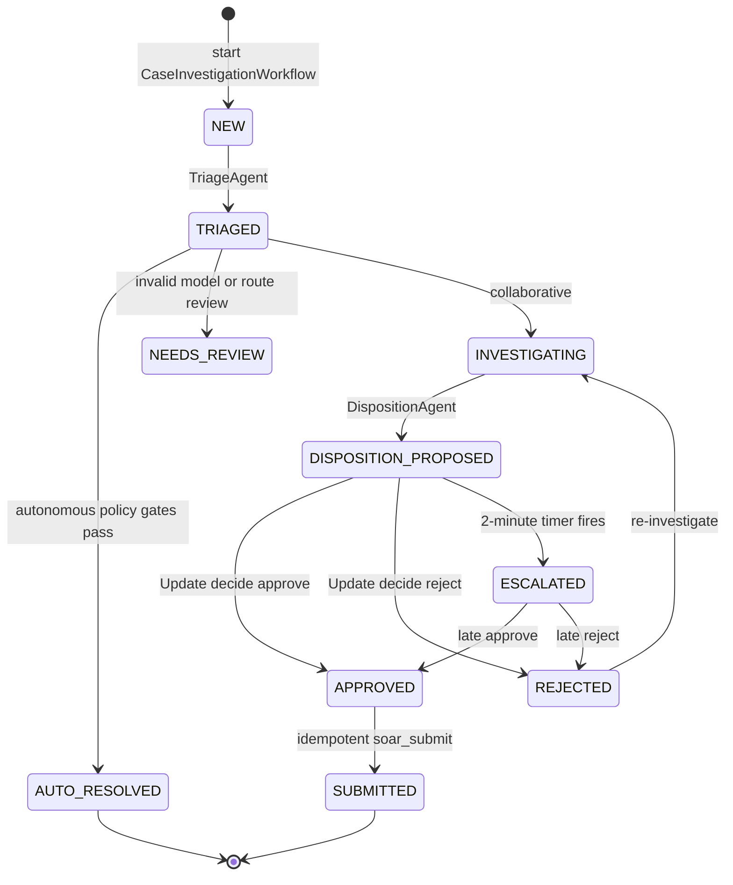
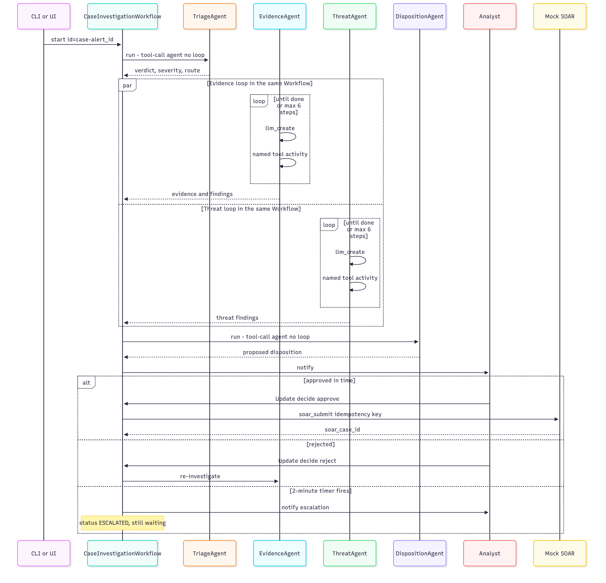
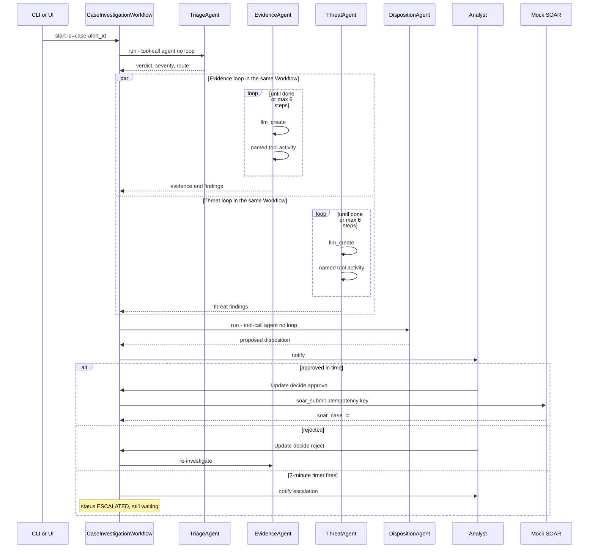
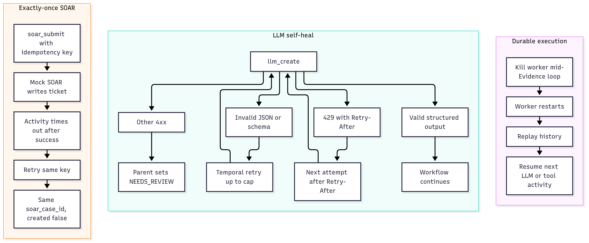
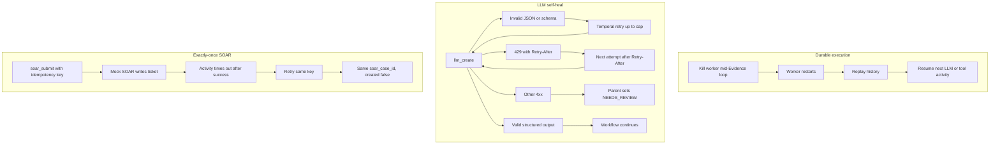

# Temporalizing the SOC case workflow

Design for Vihag's Temporal Solutions Architect take-home: a **lean, readable** standalone **Python SDK** app that runs the FORGE × LEGION SOC case flow as durable AI agents. Reviewers will read the repo offline; Vihag will screen-share the code. The bar is that a practiced reader can grasp it in about 15 minutes. Start them at [`CODE_TOUR.md`](CODE_TOUR.md). Run the interview from [`DEMO.md`](DEMO.md). Start the app from [`README.md`](README.md).

Source system: [`vihag/forge-legion`](https://github.com/vihag/forge-legion) `@` `08deab4`. Assignment: [SA Technical Exercise](https://docs.google.com/document/d/1SNyDVCrmfwBt1TCc_mnrmB1LeqcRGSE1UR3SnrVCN6g). AI framing: [Temporal AI solutions](https://temporal.io/solutions/ai) and the [AI Cookbook](https://docs.temporal.io/ai/cookbook/).

Intended public repo: **`vihag/temporal-soc-agents`** (not created in this design phase). This package lives at `/workspace/temporal-soc-takehome` until then.

Row IDs such as `[C3, E3]` refer to the mapping in §0 and [`CHECKLIST_MAPPING.md`](CHECKLIST_MAPPING.md).

## Decisions (locked unless noted)

| Topic | Decision | Why |
| --- | --- | --- |
| Repo name | `temporal-soc-agents` | Clear on a first glance |
| LLM API | OpenAI-compatible **Chat Completions** to xAI (`base_url=https://api.x.ai/v1`) | Matches how forge-legion already talks to Grok; xAI's public chat surface |
| Default model | `grok-4.3` with `reasoning_effort=none` | [Current official list](https://docs.x.ai/docs/models) (25 Nov 2026). `grok-3-mini` is no longer on that list. Do not use 4.5+ in the demo. Price: $1.25 / $2.50 per 1M tokens |
| Agents | One Evidence **loop**; Threat in parallel via `asyncio.gather`, **on for the Cloud demo** unless cost says otherwise (`ENABLE_THREAT_AGENT=0` to save tokens) | Showcase gather() in one history; can be turned off for cheaper rehearsals |
| Approval timeout | **2 minutes** for the demo (overridable) | Fits a live review; tests time-skip |
| Auto-resolve | **Included** as a short branch after triage | Cheap to keep; behind the same policy gates |
| `decide` | Temporal **Update**, not a Signal | Synchronous validation (analyst + phase) |
| Child Workflows | **Cut** | Extra IDs, files, and history to navigate. Parallelism is `asyncio.gather` in the parent `[C6]` |
| LiteLLM | **Cut** | A second client stack for no demo gain `[E1]` |
| Dynamic tool registry | **Cut** | Named tool Activities and an explicit list of Tool classes in one file |
| Spend cap | **$50** all-in | See §11. Fixture mode is the default in tests/CI |

FORGE will implement against this brief, same SDLC as forge-legion, but with **fewer, smaller PRs**.

---

## 0. Challenge checklist → showcase

Canonical copy: [`CHECKLIST_MAPPING.md`](CHECKLIST_MAPPING.md). Kept here so the design stands alone.

| ID | Checklist item | How this SOC build showcases it | Demo moment | Evidence artifact | Priority |
| --- | --- | --- | --- | --- | --- |
| **A. Assignment** | | | | | |
| A1 | Choose a use case and Temporalize it | SOC case investigation from FORGE × LEGION: alert → triage → Evidence (optional Threat) → disposition → approval → exactly-once SOAR | Open with the business problem and the form-factor change | §1; forge-legion `state.py` | must |
| A2 | Temporal SDK | Python SDK, short class-based tree: one Workflow, one Agent hierarchy, one worker | Walk `CaseInvestigationWorkflow.run` and the four Agent subclasses | `workflow.py`, `agents.py` | must |
| A3 | Diagrams | Architecture, derived states, sequence, failure/retry | PNGs, then live history | `diagrams/*.png` | must |
| A4 | 5–6 hours, not completeness | LOC budget, $50 cap, four implementation PRs | Say the cuts out loud | §11, §13, §14 | must |
| A5 | Mock externals | Mock Splunk and Mock SOAR as compose services. Grok when a key is set; fixture default in tests/CI | Fixture scenario, optional live triage | `services/mock_*.py`, `llm.py` | must |
| A6 | Compiles and runs | `docker compose up` or a 3-terminal fallback | Follow the README | `README.md` | must |
| A7 | README + start command | Plus `CODE_TOUR.md` and `DEMO.md` | Open CODE_TOUR in the repo | those three files | must |
| A8 | Public GitHub repo | `vihag/temporal-soc-agents` (not created yet) | Paste the URL | pending | must |
| A9 | Explain every line, including AI-written | Small OOP tree; Vihag reviews every PR | CODE_TOUR order, interviewer picks a file | `CODE_TOUR.md` | must |
| A10 | $50 total spend cap | Fixtures in CI; cheap current model; local Temporal for build; Cloud credits for the interview; four pinned Cursor runs | Cost table if asked | §11 | must |
| **B. Interview format** | | | | | |
| B1 | 20–30 min exercise review | `DEMO.md` ordered around distributed-systems challenges; Temporal detail in drawers | Run DEMO.md; open one drawer | `DEMO.md` | must |
| B2 | 10–15 min app-dev / distributed-systems Q&A | Short prepared answers | Leave time | `DEMO.md` | must |
| B3 | Candidate Q&A | Two or three questions | Ask one | `DEMO.md` | nice |
| **C. Capabilities** | | | | | |
| C1 | Durable execution / crash recovery | One parent Workflow; completed Activities are not re-run | Kill worker mid-Evidence loop, restart | Temporal UI; `tests/test_workflow.py::test_replay_is_deterministic`, `::test_worker_restart_resumes_without_rerunning_activities` | must |
| C2 | Retries and timeouts | Per-Activity policy; `LLMClient(max_retries=0)` | Fixture 500; show retries in the drawer | `llm.py`, `activities.py` | must |
| C3 | Exactly-once side effects | `case-{alert_id}` + `soar-submit-{alert_id}` + Mock SOAR unique on `case_id` | Duplicate start; timeout-after-success, one ticket | `soar.py` | must |
| C4 | Query / Update HITL | Query `get_case`; Update `decide`; `wait_condition` | Approve in the UI | `workflow.py` | must |
| C5 | Timers / escalation | 2-minute demo timer → `ESCALATED`, late decide still works | Time-skipping test | `tests/test_simulations.py::test_simulation[approval_timeout_escalated]` | must |
| C6 | Parallelism, no child Workflows | `asyncio.gather` of Evidence and Threat in the parent | Overlapping Activities in one history | `workflow.py` | should |
| C7 | Determinism / versioning | No I/O in Workflow or `Agent.run`; `patched` only if needed | Point at those two files | `workflow.py`, `agents.py` | should |
| C8 | Temporal UI + our drawers | Activity I/O in Cloud UI; "What Temporal did here" drawer in the case app | Open the triage drawer, then the Cloud link | UI; namespace `quickstart-vihaggupta.om7xm` | must |
| C9 | Time-skipping tests | `WorkflowEnvironment.start_time_skipping()` | `pytest -k approval_timeout` | that test | must |
| C10 | One task queue | `soc-case`. A `soc-llm` split is talk-only | Show the worker container | `worker.py` | should |
| C11 | Cloud vs local | `ClientConfig`; profile `cloud-setup` or local compose | Same app, different profile | `README.md` | must |
| **D. AI pillars** | | | | | |
| D1 | Workflows-as-code | One Workflow orchestrates Grok, tools, notify, SOAR | Trace `run()` end to end | `workflow.py` | must |
| D2 | Durable AI sessions | Wait survives a down worker | Stop worker after notify, approve later | C1 + C5 | must |
| D3 | Happy path only — no `state.py` table | Status set only by `_enter()` in `run()` | `state.py` next to `run()` | §4 | must |
| D4 | Approve agent decisions | SOAR only after `decide(approve)` | Reject, re-investigate, approve | Update `decide` | must |
| D5 | Self-heal LLM + rate limits | Capped retries; 429 → Retry-After; other 4xx → `NEEDS_REVIEW` | Bad JSON twice, then success | `llm.py` | must |
| D6 | Parallel agents | Two Agent subclasses, one Workflow | One case, overlapping tool calls | `agents.py` | should |
| D7 | Testable | Stub LLM; time-skip; SOAR once; no key in CI | `pytest` green | `tests/` | must |
| D8 | LLM I/O visible | Drawer + Temporal UI, including model requested vs returned | Open the triage drawer | UI | must |
| D9 | Langfuse | Out of cut and budget | If asked | — | nice |
| **E. Cookbook recipes** | | | | | |
| E1 | LLM as an Activity | `LLMClient` only from `llm_create`. No LiteLLM | Show `llm.py` | `llm.py` | must |
| E2 | Tool-calling agent, no loop | `TriageAgent`, `DispositionAgent` | Triage is 1–3 Activities | `agents.py` | must |
| E3 | Agentic loop | `EvidenceAgent`, `ThreatAgent`: loop in `Agent.run()`, named tools, cap 6 | Evidence calls `search_evidence`, then stops | `agents.py`, `tools.py` | must |
| E4 | HITL recipe | `wait_condition` + timer; Update instead of Signal | Approve / reject / timeout | `workflow.py` | must |
| E5 | Retry-After | Mapped in `LLMClient` | Fixture 429 | `llm.py` | should |
| E6 | Structured outputs | Pydantic; invalid → D5 | Fixture omits `verdict` | `models.py` | should |

---

## 1. Use case and framing `[A1, D1]`

A SOC alert must become a disposition (false positive, benign, escalate, contain) and, when the action is escalate or contain, a single SOAR ticket. The path is long-running, branches on model output and policy, fans out to specialist agents, and blocks on a human.

forge-legion solved this with a Case API state machine, a LangGraph worker, and a crew of Grok Bots woken by a webhook. That is a good agentic-SOC demo and a weak Temporal demo. This take-home keeps the domain and changes the runtime: one Workflow per case, specialist agents as classes the Workflow calls, an analyst UI instead of a group chat, mocked Splunk and SOAR, real Grok only when a key is present.

CENTURION's job (intake, fan-out, wait, clear SOAR) is `CaseInvestigationWorkflow`. That is the form-factor change.

---

## 2. Architecture `[A3, C11, D1]`





Four application processes, plus the Temporal server. Each split is justified; we do not split further.

| Service | Why it is separate |
| --- | --- |
| `temporal-worker` | The orchestration runtime. Must be restartable on its own (the kill-the-worker demo) `[C1]` |
| `analyst-api` | FastAPI + the case UI. Stateless Temporal client. Reviewers can see that the web app does not own case state |
| `mock-splunk` | SIEM stand-in with a tiny HTTP API. Swappable later without touching the Workflow |
| `mock-soar` | Actioning stand-in. Owns submit idempotency. Never calls back into the Workflow |
| Temporal dev server | Local default. For the interview, point the same worker and API at Cloud via `TEMPORAL_PROFILE=cloud-setup` `[C11]` |

Not separate services: routing policy, notify, LLM, agents, a gateway, a database. Case state lives in Temporal. The API queries it.

The UI talks only to `analyst-api`. The CLI is a direct Temporal client (start, Query, Update), resolved in T1. They start Workflows, call `decide`, and read `get_case`. They also fetch a small "insight" payload for the drawers (history excerpt, retries, LLM I/O, Temporal UI link).

---

## 3. Derived case states `[A3, D3]`





These names are **query projections**, not rows in a transition table. `Case.status` is a property on the domain object so the UI can show a badge. The Workflow never calls `check_transition()`. `soar_submit` is simply the next line after `decide(approve)` returns.

`ESCALATED` is new versus forge-legion (no durable approval timer there). `AUTO_RESOLVED` and `NEEDS_REVIEW` stay so the interview can map to the old routing policy.

---

## 4. What we keep from `state.py`, and the pain this removes `[D3, C3]`

Kept, as ordinary code in the Workflow or on `Case` / `RoutingPolicy`:

| Old rule (08deab4) | Where it goes now |
| --- | --- |
| Happy path NEW → TRIAGED → INVESTIGATING → DISPOSITION_PROPOSED → APPROVED → SUBMITTED | Body of `CaseInvestigationWorkflow.run` |
| Findings do not jump to disposition | Only `DispositionAgent` proposes |
| Approve/reject only from the proposal, and only `actor.type == analyst` | Enforced in the `decide` Update |
| Reject then new work returns to INVESTIGATING | `decide(reject)` loops back, capped |
| SOAR only from APPROVED, only once, only with a stored approve | Unreachable until the Update returns; Mock SOAR unique on case id; Activity idempotency key |
| Auto-resolve only from TRIAGED, with policy gates | Short branch after triage |
| Model failure or `route=review` → NEEDS_REVIEW | After capped LLM retries, or the policy function |
| Append-only audit | Temporal event history. The Query projects a short timeline |

| Pain in forge-legion | Temporal fix |
| --- | --- |
| `TRANSITIONS` + HTTP 409 when a bot is in the wrong state | The illegal call has no line to execute `[D3]` |
| Triage worker has no durable retry/backoff | Activity retries + schema self-heal `[C2, D5]` |
| CENTURION woken by a webhook over a tunnel | `Agent.run()` from the Workflow. No webhook `[D1]` |
| Silent-bot watchdog unimplemented | Durable 2-minute timer `[C5]` |
| SOAR down leaves APPROVED; the caller retries by hand | The Workflow retries `soar_submit`; the key prevents a second ticket `[C3]` |
| Always-on bots and SQLite as the state owner | The Workflow *is* the state `[D2]` |
| Vendor-client retries fighting durable recovery | `max_retries=0` on `LLMClient` `[E1]` |

`RoutingPolicy.decide()` stays a pure method (port of `routing.py`). Model `recommended_route` remains advisory.

---

## 5. Code shape: OOP, files, LOC budget `[A2, A4, A9]`

### 5.1 Classes (single responsibility)

| Class | File | Responsibility |
| --- | --- | --- |
| `Case`, `Evidence`, `Finding`, `Disposition`, `Decision`, `CaseView` | `models.py` | Domain data. `Case.status` is written only by the Workflow's happy path (`_enter`). No I/O |
| `RoutingPolicy` | `models.py` | Pure route decision |
| `Agent` (base) | `agents.py` | Shared `run()` mechanics: call `llm_create`, optionally a tool, append history. Subclasses set instructions, tool names, and whether to loop |
| `TriageAgent`, `DispositionAgent` | `agents.py` | E2: at most one tool, then a structured result |
| `EvidenceAgent`, `ThreatAgent` | `agents.py` | E3: loop until the model stops or `MAX_AGENT_STEPS` (default 6) |
| `LLMClient`, `FixtureLLMClient` | `llm.py` | Chat Completions to xAI, or recorded fixtures. Used only from the `llm_create` Activity |
| `Tool` (base) + one class per tool | `tools.py` | `name`, `schema`, `run()`. Talk to Mock Splunk |
| `SoarClient`, `HttpSoarClient` | `soar.py` | Submit with the same idempotency behaviour as forge-legion's mock |
| `CaseInvestigationWorkflow` | `workflow.py` | Happy path, Query, Update, timer, `asyncio.gather` |

Activity functions in `activities.py` are thin: they construct a client or tool and call it. That keeps I/O out of the Workflow sandbox without hiding it behind a framework.

### 5.2 Target tree and LOC budget

**Budget: under 1,500 Python LOC excluding tests and UI.** UI = `api.py` + `ui/`. Counts below are design targets, not a promise to the byte, and include the two mock services.

```
src/soc/
  __init__.py              ~5
  settings.py             ~40    env: model, timeouts, caps, compose URLs
  models.py              ~140    Case and friends, RoutingPolicy
  workflow.py            ~180    the only Workflow
  agents.py              ~240    Agent + four subclasses
  activities.py          ~120    llm_create, run_tool, fetch_alert, notify, soar_submit
  llm.py                 ~100    LLMClient, FixtureLLMClient
  tools.py               ~150    Tool + five tools
  soar.py                 ~70    SoarClient
  worker.py               ~50    Worker process
  cli.py                  ~80    start, view, decide
services/
  mock_splunk.py         ~120    small HTTP service
  mock_soar.py            ~90    small HTTP service, unique on case_id
                               ------
                               ~1,385  (stay under 1,500)

# Excluded from the budget (still keep them small)
src/soc/api.py           ~180    FastAPI: list, view, decide, insight
src/soc/ui/index.html    ~400    queue, detail, drawers (one file, like the ClickHouse demo)
tests/                   ~500    time-skipping, retries, SOAR, self-heal
compose.yml, Makefile, .env.example
CODE_TOUR.md, DEMO.md, README.md, DESIGN.md
```

Six files a reviewer must read, in order, are listed in `CODE_TOUR.md`: `models.py` → `workflow.py` → `agents.py` → `activities.py` + `llm.py` → `tools.py` + `soar.py` → `api.py` / UI drawers.

### 5.3 What we will not add

Separate packages per agent, child Workflow modules, a tool plugin registry, LiteLLM, a second task queue, a Case API, MCP, nginx, Kubernetes, Langfuse.

---

## 6. Workflow and activity breakdown `[E1, E2, E3, E4, C6]`

### 6.1 `CaseInvestigationWorkflow.run(alert_id)`

Workflow ID: `case-{alert_id}` `[C3]`. Task queue: `soc-case`.

1. `fetch_alert` Activity. Status `NEW`.
2. `TriageAgent().run(case)` (E2). `RoutingPolicy.decide()`. `TRIAGED`, or `AUTO_RESOLVED` / `NEEDS_REVIEW` and return.
3. `asyncio.gather(EvidenceAgent().run(case), ThreatAgent().run(case))` if Threat is enabled; otherwise Evidence only. Status `INVESTIGATING`.
4. `DispositionAgent().run(case)` (E2). Status `DISPOSITION_PROPOSED`.
5. `notify` Activity, then `wait_condition` for `decide`, timeout 2 minutes (E4, C5).
6. Approve → `soar_submit` → `SUBMITTED`. Reject → loop to step 3 or 4, cap 2. Timeout → `ESCALATED`, notify, keep waiting.

### 6.2 Agents `[E2, E3]`

All four live in `agents.py`. The base class is the cookbook loop (or the one-shot variant) in one place:

- `TriageAgent` / `DispositionAgent`: `loop=False`. Tools: `get_alert` + `list_alert_evidence`, and `list_findings`, respectively.
- `EvidenceAgent` / `ThreatAgent`: `loop=True`, `max_steps=6`. Evidence tools: `search_evidence`, `list_alert_evidence`, `lookup_asset`. Threat tools: `enrich_ioc`, `lookup_mitre`, `get_evidence`.

`Agent.run()` may only call `workflow.execute_activity`. It must not open sockets or read the clock.

Tool dispatch is a small `if name == ...` (or a dict of Activity functions) in `activities.run_tool`. Five named tools, one file, no plugin loader.

### 6.3 LLM Activity `[E1, D5, E5, E6]`

`LLMClient.complete(model, messages, tools, max_tokens)` from `llm_create`.

- `AsyncOpenAI(base_url=..., api_key=..., max_retries=0)`.
- Chat Completions with tools, not the OpenAI Responses API (xAI compatibility).
- Default model `grok-4.3`, `reasoning_effort=none`, `max_tokens` capped (e.g. 800).
- `FixtureLLMClient` when `GROK_CLIENT=fixture` or `XAI_API_KEY` is unset.
- 5xx / timeout / invalid schema: Temporal retries, capped. 429: Retry-After. Other 4xx: non-retryable → `NEEDS_REVIEW`.
- Store `model_requested` and `model` returned `[D8]`.

### 6.4 Other Activities

| Activity | Timeout | Retry |
| --- | --- | --- |
| `fetch_alert` | 10s | 3 attempts |
| `llm_create` | 30s | 5 attempts; 4xx except 429 not retried |
| `run_tool` | 15s | 3 attempts |
| `notify` | 10s | 3 attempts; failure must not block the wait |
| `soar_submit` | 15s | 5 attempts; key `soar-submit-{alert_id}` |

### 6.5 Sequence `[A3, C5, C6, E4]`





### 6.6 Failure and retry `[C1, C2, C3, D5]`





---

## 7. Signals, Queries, Updates `[C4, E4, D4]`

| Kind | Name | Purpose |
| --- | --- | --- |
| Query | `get_case` | CaseView: status, triage, evidence, findings, disposition, decision, SOAR receipt, timeline |
| Query | `approval_pending` | Boolean plus the open disposition |
| Update | `decide(decision, rationale, analyst_id)` | `approve` or `reject`, analyst only, only while waiting. Returns the new CaseView |

No v1 Signal. Notes can wait.

---

## 8. Workflow IDs and exactly-once SOAR `[C3]`

| Resource | ID |
| --- | --- |
| Workflow | `case-{alert_id}` — second start raises `WorkflowAlreadyStartedError` |
| SOAR Activity | Idempotency key `soar-submit-{alert_id}` |
| Mock SOAR | Unique on `case_id`; retry returns the original id with `created=False` |

No child Workflow IDs to explain.

---

## 9. Human-in-the-loop `[C5, D4, E4]`

After a disposition is proposed: `notify`, then `wait_condition(..., timeout=2 minutes)`. On timeout: `notify` escalation, status `ESCALATED`, wait again without a short timeout. A late `decide` still works. Approve continues to SOAR. Reject increments a rework counter (cap 2) and returns to investigation.

The worker holds no thread during the wait. The process does not need to be up `[D2]`.

---

## 10. Analyst UI and "What Temporal did here" drawers `[C8, D8]`

A SOC-looking app, not a bot room: **case queue**, **case detail** (status, timeline, findings, evidence), **Approve / Reject**.

Deep Temporal and LLM detail is *not* dumped on the detail page. It opens on demand in a right-hand **drawer**, the same pattern as Vihag's ClickHouse trade-decision demo (`ch-trade-demo` `app/static/index.html`): a `#scrim` + `#drawer` slide-over, triggered by a modest "SQL + EXPLAIN"-style link (here labelled **What Temporal did here**), Esc / scrim / × to close, a short prose lead, then the exact artifact, then a link out to the real console.

| Trigger on the case UI | Drawer shows |
| --- | --- |
| A timeline step (triage, a tool call, disposition, SOAR) | Which Activity ran, attempt count, the Workflow/Activity snippet (file + symbol), a short event-history excerpt, link to this Workflow in the Temporal UI |
| An LLM step | Prompt, tools, raw response, `model_requested` vs `model` returned |
| A retried step | Attempt list and why it retried |
| The approval banner | The Update payload we will send, and the timer remaining |

The analyst can run the whole demo without opening a drawer. The SA can go as deep as they want without leaving the app, and can still jump to Temporal Cloud.

Implementation stays one HTML file plus `api.py`. A `/history` endpoint reads the event history through the Temporal client, and the drawers render from it. Do not build a generic "observability product."

**Self demo mode** (added in T3, modelled on the temporal.io homepage demo): a scenario dropdown (the five simulations), a *Workflow runs → Something breaks → It recovers* stepper, Pause / Start over, the real `workflow.py` with the executing line highlighted, and a Gantt-style event timeline (workflow, each Activity, failed attempts as red segments, durable timers, Update markers) polled every ~1s from the real history. It uses the same drawers.

The CLI remains for scripting and for a fallback if the UI is not up:

```bash
uv run python -m soc start --scenario hitl-confirm-01
uv run python -m soc view case-SPL-2026-0001
uv run python -m soc decide case-SPL-2026-0001 approve --analyst vihag --rationale "Evidence matches the alert"
```

---

## 11. Cost cap: $50 `[A10]`

All figures in USD. Grok prices from [xAI Models](https://docs.x.ai/docs/models) as of 25 Nov 2026. Temporal credits from [Temporal Cloud pricing](https://temporal.io/pricing.md). Cursor figures are a budget, not a vendor quote.

### Estimate per live collaborative case

Assume Evidence + Threat, average 4 loop steps each (capped at 6), plus triage and disposition:

| Step | LLM calls (avg) | Input tokens | Output tokens |
| --- | --- | --- | --- |
| Triage | 2 | 5,000 | 1,200 |
| Evidence loop | 4 | 17,000 | 2,000 |
| Threat loop | 4 | 17,000 | 2,000 |
| Disposition | 2 | 8,000 | 1,200 |
| **Total** | **12** | **~47,000** | **~6,400** |

At `grok-4.3` / `$1.25` in / `$2.50` out: **about $0.08 per case**. Leave Threat off and it is closer to $0.05. Turning on reasoning effort would raise output (and cost) sharply — that is why the default is `none`.

### Cap table

| Line | Planned use | Expected | Budget in the $50 |
| --- | --- | --- | --- |
| Grok API | Tests/CI on fixtures (**$0**). Live: smoke, 2–3 rehearsals, the interview. Budget **20 live cases** (~$1.60) plus a margin for a longer loop or a mistaken retry | ~$2 | **$10** |
| Temporal Cloud | Build on the **local** dev server (**$0**). Interview on existing namespace `quickstart-vihaggupta.om7xm`. New accounts get **$150 credits / 90 days**; a dozen demo cases are cents of Actions | $0 out of pocket | **$0** |
| Cursor cloud (FORGE) | **Four** implementation runs, pinned **composer-2.5**, no max mode, one at a time, one steer each. Docs PRs are local | The main cost risk | **$35** |
| Hosting | None. Laptop + compose | $0 | **$0** |
| **Total** | | | **$45**, **$5 reserve** |

If a Cursor run looks likely to blow the remainder, stop it and finish that PR locally. Do not add a fifth cloud run without an explicit okay.

### Guardrails (implement these)

- `GROK_CLIENT=fixture` is the default in `.env.example`, tests, and CI. Live Grok requires an explicit key **and** `GROK_CLIENT=http`.
- `MAX_AGENT_STEPS=6`. `LLM_MAX_TOKENS=800`. `reasoning_effort=none`.
- Auto-resolve and Threat can be toggled; rehearsals that are not the "parallel agents" beat should leave Threat off.
- Do not leave a Cloud worker running overnight.
- Log prompt/completion tokens on every `llm_create` (visible in the drawer) so a runaway is obvious.

---

## 12. Scope cut `[A4]`

**Must:** parent Workflow; four Agent classes (Threat may be disabled at runtime); HITL Update + 2-minute escalation; auto-resolve branch; mocks; Grok + fixture; Query; drawers + queue/detail UI; time-skipping tests; README, CODE_TOUR, DEMO; Cloud and local; kill-the-worker demo; cost guardrails.

**Should:** Threat enabled in the recorded demo `[C6, D6]`; Retry-After `[E5]`; structured-output tests `[E6]`; reject → re-investigate once.

**Out:** child Workflows, LiteLLM, tool plugin registry, Langfuse, split queues, Worker Versioning (talk only), Case API / MCP / console rebuild, Kubernetes.

---

## 13. Companion reviewer docs `[A7, B1]`

Shipped in this package and kept current as code lands (CODE_TOUR line anchors are filled in T4):

- [`README.md`](README.md) — quickstart only.
- [`CODE_TOUR.md`](CODE_TOUR.md) — six files, in order, with what to look at.
- [`DEMO.md`](DEMO.md) — step-by-step interview script.

---

## 14. Build plan for FORGE

Same loop as forge-legion: Lead frames one contract → Architecture writes `contracts/T*-contract.md` → one pinned composer-2.5 Cursor cloud run → CI → QA → one steer, one QA retry → ARCHON merges and laptop-verifies. One run at a time. No secrets in git. Vihag reviews every PR `[A9, A10]`.

**Fewer PRs than C1–C10.** Four implementation contracts after this design package.

### Contracts to freeze first

T0 is this package. T1 freezes models, Workflow ID scheme, Query/Update signatures, and the class list in §5. T2 freezes the LLM request/response, fixture behaviour, and error taxonomy. Do not start T3 until T1–T2 are accepted.

### Phases

| Phase | PR title shape | What lands | Acceptance | Out of this PR |
| --- | --- | --- | --- | --- |
| T0 | `docs(T0): design, mapping, tour, demo, README` | This package in the new repo | Files present; PNGs render; IDs stable | Code |
| T1 | `feat(T1): workflow, agents, HITL, fixture path` | `models.py`, `workflow.py`, `agents.py`, activities, fixture LLM, in-process or stub tools, Mock SOAR idempotency, CLI, worker, tests for happy path, `decide`, timeout (time-skip), duplicate ID, SOAR exactly-once | `pytest` green with fixtures; CLI can start / view / decide a case to SUBMITTED; kill-worker can be rehearsed | Live Grok, compose UI, Threat can be a stub that returns one finding |
| T2 | `feat(T2): Grok client, tools, mock Splunk, Threat loop` | `LLMClient` to xAI, five tools, `mock_splunk` service, real Evidence/Threat loops, caps, token logging, optional live `python -m soc grok-smoke` (exit 2 if no key) | `test_llm_self_heal`, `test_evidence_loop_uses_tool`, `test_parallel_agents`; smoke optional | UI |
| T3 | `feat(T3): analyst UI, drawers, compose` | `api.py`, `ui/index.html` (queue, detail, approve/reject, drawers), `compose.yml`, README start command, Cloud profile notes | UI can view and approve a local case; a drawer shows history + Temporal link; `docker compose up` matches README | Langfuse, extra styling passes |
| T4 | `test(T4): tour line anchors, demo dry-run, polish` | Fill CODE_TOUR line refs, run DEMO.md on compose, leftover must-row tests | All must-rows have a test or a documented live step; `pytest` green without a key; Vihag can walk CODE_TOUR in 15 minutes | New features |

T1 is the first interview-demoable CLI path. T3 is the form-factor we want on the call. Do not add T5.

### Guardrails for implementers

1. Sequencing lives in the Workflow, not in the UI.
2. Status is set in one place, by the Workflow's happy path. No `TRANSITIONS` table `[D3]`.
3. All I/O is an Activity. LLM client retries stay off `[E1]`.
4. Agents and tools are the classes in §5 — do not add layers.
5. Mock Splunk is read-only plus fixtures. Mock SOAR owns submit idempotency.
6. `soar_submit` is unreachable until `decide(approve)` returns.
7. No secrets in git. Fixture mode is the test default `[A10]`.

### Laptop verification (ARCHON)

Follow `README.md`: compose up, `pytest`, start `hitl-confirm-01`, open the case, approve, confirm SUBMITTED and one SOAR id, open one drawer. Optional: same path with `TEMPORAL_PROFILE=cloud-setup`.

---

## 15. Open questions

All previously open questions are **resolved** (Vihag, 10:11 PM SGT, 25 Nov 2026):

1. **Live model:** `grok-4.3` with `reasoning_effort=none`. Confirmed. (`grok-3-mini` is no longer on the official list; do not use 4.5+.)
2. **Threat in the Cloud demo:** **on**, unless cost says otherwise (about $0.08/case with both loops; turn `ENABLE_THREAT_AGENT=0` for cheaper rehearsals).

Locked defaults that were already closed: repo name `temporal-soc-agents`, Chat Completions to xAI, one Evidence loop, 2-minute approval timeout, auto-resolve included, Update for `decide`, no child Workflows, no LiteLLM, no dynamic tool registry.
