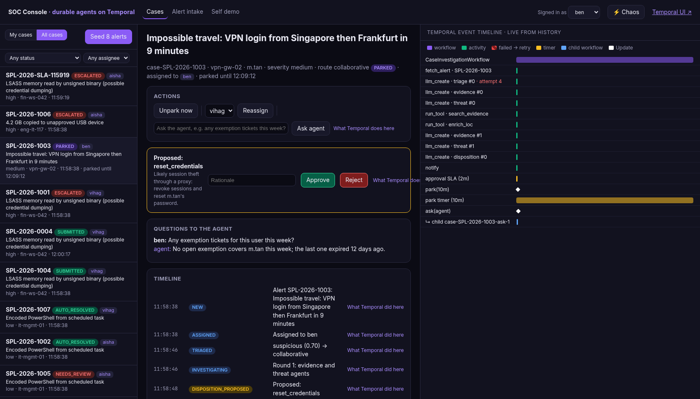

# temporal-soc-agents

A lean Temporal Python SDK app: a **SOC console** where alerts arrive on a queue, each becomes a durable case Workflow, AI agents investigate (triage, an Evidence loop and a parallel Threat loop, a disposition), and analysts work the case: reassign it, park it, ask an agent a follow-up, approve or reject. The SOAR submit is exactly-once. A chaos panel breaks the queue, Splunk, Grok, SOAR or the worker on demand, so you can watch Temporal absorb it on a live event timeline.

Read this quickstart first. Then [DEMO.md](DEMO.md) (the presenter runbook), [CODE_TOUR.md](CODE_TOUR.md) (a 15-minute walk through the code) and [CHECKLIST_MAPPING.md](CHECKLIST_MAPPING.md) (requirement → code → test). Design notes: [DESIGN.md](DESIGN.md) (v1) and [DESIGN-v2.md](DESIGN-v2.md) (the console slice).

Everything runs in **fixture mode** by default: Mock Grok replays recorded model turns, and Splunk, SOAR and the alert queue are local mocks. No API key, no spend.



## Quickstart (no Docker): the full demo, chaos panel included

```bash
temporal server start-dev                       # terminal 1, Temporal UI on :8233
uv sync                                         # or: pip install -e . pytest pytest-asyncio
uv run python -m soc api --with-worker          # terminal 2: console on :8080, worker + 4 mocks in-process
uv run python -m soc seed                       # terminal 3: push 8 alerts (one is a duplicate)
```

Open http://localhost:8080. **Cases** is the console (pick who you are top right; *My cases* / *All cases*; filters). **Alert intake** shows the intake loop. **Self demo** runs the five narrated scenarios. **⚡ Chaos** opens the chaos panel.

## Quickstart (Docker Compose)

```bash
cp .env.example .env
docker compose up --build                       # console :8080, Temporal UI :8233
docker compose exec analyst-api python -m soc seed
```

Here the worker is its own container, so the crash drill is `docker compose kill worker` then `docker compose start worker` (the in-UI *Kill worker* button needs `api --with-worker`).

## CLI

```bash
uv run python -m soc seed                                     # 8 alerts onto the queue
uv run python -m soc chaos splunk 20                          # queue | splunk | grok | grok429 | soar
uv run python -m soc view case-SPL-2026-1001
uv run python -m soc reassign case-SPL-2026-1006 aisha --by ben --reason "handover"
uv run python -m soc park case-SPL-2026-1003 300 --analyst ben
uv run python -m soc unpark case-SPL-2026-1003 --analyst ben
uv run python -m soc ask case-SPL-2026-1003 "Any exemption tickets for this user this week?" --analyst ben
uv run python -m soc decide case-SPL-2026-1001 approve --analyst vihag --rationale "matches"
uv run python -m soc simulate --all                           # five narrated self-driving scenarios
uv run python -m soc worker                                   # a standalone worker (also starts intake)
uv run pytest -q                                              # 26 tests on a time-skipping server
```

To run every process separately: `python -m services.mock_splunk` (:8001), `mock_soar` (:8002), `mock_grok` (:8003), `mock_queue` (:8004), then `python -m soc worker` and `python -m soc api`.

## Live Grok (optional)

In `.env`, set `GROK_CLIENT=http` and `XAI_API_KEY=...` (model `grok-4.3`, `reasoning_effort=none`, `LLM_MAX_TOKENS=800`). Then restart the worker. `uv run python -m soc grok-smoke` makes one live call, or exits 2 without a key. Tests and CI never call Grok. The spend cap is in DESIGN.md §11.

## Temporal Cloud

Connection uses Temporal's standard env config, so the same code runs on Cloud. Set `TEMPORAL_ADDRESS`, `TEMPORAL_NAMESPACE` and `TEMPORAL_API_KEY` (or `TEMPORAL_PROFILE=<profile>` with a `temporal.toml`). Set `TEMPORAL_UI_URL=https://cloud.temporal.io` so the console's links open Cloud. With Compose, run everything except `temporal`:

```bash
docker compose up --build worker analyst-api mock-splunk mock-soar mock-grok mock-queue
```

Never commit API keys; `.env` is git-ignored.
